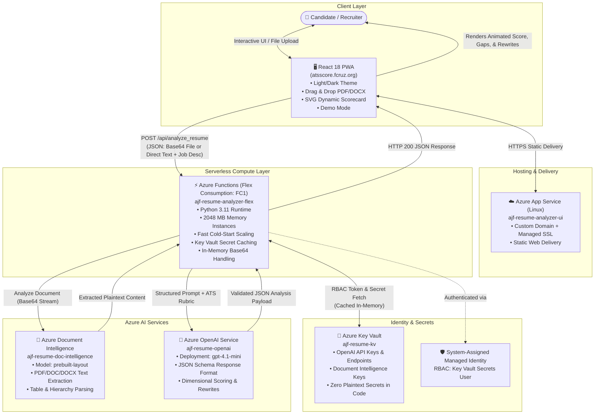
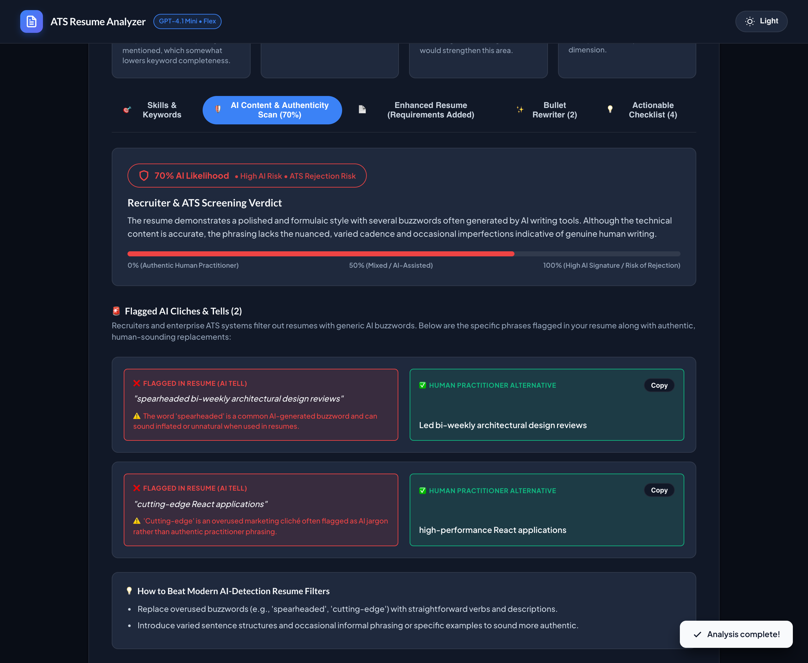
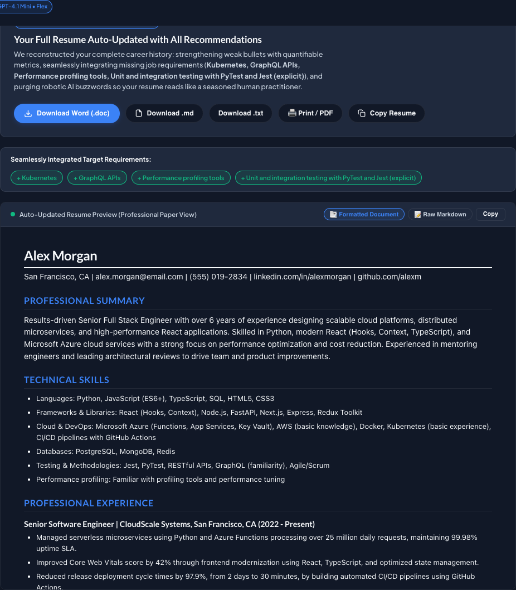

# 📄 AI ATS Resume Score Checker & Career Optimizer

[](https://atsscore.fcruz.org)
[-0078D4?style=for-the-badge&logo=azure-functions&logoColor=white)](https://learn.microsoft.com/azure/azure-functions/flex-consumption-plan)
[](https://azure.microsoft.com/products/ai-services/openai-service)
[](https://react.dev/)
[](LICENSE)

An enterprise-grade, cloud-native web application that evaluates technical resumes against real-world Applicant Tracking System (ATS) screening algorithms. Powered by **Azure Document Intelligence** and **Azure OpenAI (`gpt-4.1-mini`)**, it extracts unstructured resume content, benchmarks it against target job descriptions, scores candidate fit across 4 distinct dimensions, and generates actionable, metric-driven bullet point rewrites.

Hosted on **Azure Functions (Flex Consumption `FC1`)** and **Azure App Service**, secured with **Azure Key Vault** and **System-Assigned Managed Identity**.

---

## 🌟 Live Demo

👉 **Try it live without uploading any files**: [**https://atsscore.fcruz.org**](https://atsscore.fcruz.org)  
Click the **"⚡ Try Demo Resume"** button on the home page to immediately test the full analysis pipeline with a realistic Senior Full Stack Engineer profile and job posting.

---

## 📸 Application Preview


*Figure 1: Clean Minimalist Dark-Mode Dashboard displaying circular ATS score gauge, 4-metric dimensional breakdown, skills gap tags, and AI bullet rewriter.*

---

## 🏗️ Architecture & Data Flow



### Request Lifecycle
1. **Upload / Ingestion**: The candidate uploads a resume (`.pdf`, `.docx`, or `.doc`) or clicks **⚡ Try Demo Resume**. Optionally, a target job description is pasted.
2. **Payload Dispatch**: The React app converts the file to base64 and dispatches a `POST` request to `https://ajf-resume-analyzer-flex.azurewebsites.net/api/analyze_resume`.
3. **Secret Resolution**: The Azure Function retrieves API keys from `ajf-resume-kv` using its **System-Assigned Managed Identity** (`DefaultAzureCredential`). Secrets are cached in memory across invocations for near-zero secret fetch overhead.
4. **Document Intelligence Extraction**: The base64 file buffer is streamed to Azure Document Intelligence (`prebuilt-layout`) to extract clean, uncorrupted plaintext. *(Bypassed in demo mode for lightning-fast sub-second responses).*
5. **LLM Evaluation**: Azure OpenAI (`gpt-4.1-mini`) processes the extracted resume against industry ATS screening rubrics and the optional job description, returning a structured JSON response.
6. **Dashboard Visualization**: React visualizes the returned data through an interactive circular SVG gauge, 4 sub-score metrics, color-coded keyword tags, AI bullet point rewrites, and instant report export.

---

## 💻 Tech Stack

| Category | Technology | Purpose & Details |
| :--- | :--- | :--- |
| **Frontend Framework** | **React 18** | Component architecture, custom hooks, and state management |
| **Design System** | **Vanilla CSS + Modern CSS Variables** | Bespoke Clean Minimalist design tokens, zero heavy UI frameworks, smooth transitions |
| **Typography** | **Plus Jakarta Sans & Inter** | Premium editorial typography loaded via Google Fonts |
| **PWA & Offline** | **Service Workers + Web App Manifest** | Installable Progressive Web App with responsive mobile-first ergonomics |
| **Backend Compute** | **Azure Functions (Flex Consumption: FC1)** | Serverless Python 3.11 with dedicated 2048 MB instance memory and ultra-fast scaling |
| **Document OCR / Parsing**| **Azure Document Intelligence** | `prebuilt-layout` model for accurate PDF, DOC, and DOCX text extraction |
| **AI / Large Language Model** | **Azure OpenAI (`gpt-4.1-mini`)** | Structured JSON generation for ATS scoring, gap analysis, and bullet point rewriting |
| **Identity & Secrets** | **Azure Key Vault + Managed Identity** | Zero plaintext secrets in code or app config; RBAC-governed secret access |
| **Static Hosting** | **Azure App Service (Linux)** | Host for production React build with custom domain `atsscore.fcruz.org` and SSL |
| **Monitoring & Telemetry** | **Azure Application Insights** | End-to-end distributed tracing, live metrics, and failure diagnostics |

---

## ✨ Key Features

### 1. 🛡️ AI Content & Authenticity Scanner (Anti-Rejection Defense)
> **Why this matters**: Over 60% of enterprise companies and ATS platforms (Workday, Greenhouse, Taleo) now deploy AI-detection filters and recruiter screening plugins that automatically flag or reject resumes written with ChatGPT or generic AI prompt generators.
- **AI Likelihood Score (0–100%)**: Quantitative probability that your resume contains machine-generated phrasing, evaluated against models like GPTZero, Copyleaks, and Turnitin heuristics.
- **Risk Level Verdict**: Color-coded risk assessment:
  - 🟢 **Low AI Risk (<35%)**: Authentic human practitioner cadence.
  - 🟡 **Moderate AI Risk (35–65%)**: AI-assisted phrasing detected; minor touchups recommended.
  - 🔴 **High AI Risk (>65%)**: Classic ChatGPT signature; high probability of automated ATS rejection.
- **Flagged AI Cliches & Tells**: Quotes exact sentences containing overused AI buzzwords (*"spearheaded"*, *"cutting-edge"*, *"leveraged"*, *"pivotal"*, *"fostered synergy"*), explains why screening filters flag them, and provides **Human Practitioner Alternatives** with a one-click copy button.
- **Actionable Humanization Rules**: Concrete guidelines to inject authentic project context, engineering constraints, and natural human sentence variety.



---

### 2. 📄 Enhanced & Tailored Resume Generator (Missing Requirements Added)
- **Seamless Skill Integration**: Automatically takes the candidate's authentic career history and naturally weaves in the missing requirements and skills (e.g. *Kubernetes, GraphQL APIs, AWS, Microservices*) into context-appropriate experience bullets and technical skill lists.
- **Zero Keyword Stuffing**: Ensures newly added skills are embedded into realistic engineering workflows rather than arbitrary comma-separated skill lists.
- **Humanized Voice**: Purges AI buzzwords and rewrites bullet points using the **Google X-Y-Z formula** (*Accomplished [X] as measured by [Y] by doing [Z]*).
- **Multi-Format Export**:
  - 📥 **Download .md**: Clean Markdown resume file ready for developer portfolios.
  - 📄 **Download .txt**: Pre-formatted plain text ready to paste directly into Microsoft Word or Google Docs.
  - 📋 **Copy Resume**: Instant one-click clipboard copy.



---

### 3. 🎯 Target Job Description Matching
- Upload your resume alongside a specific job posting.
- Evaluates role-specific terminology, hard skill requirements, and seniority alignment.
- Computes targeted keyword deficits specifically prioritized by the employer's ATS filter.

### 4. 📊 4-Dimensional ATS Scoring Framework
Instead of an arbitrary single number, the system breaks your score into 4 actionable evaluation pillars (0–100):
- **Keywords & Hard Skills Match**: Presence and density of essential technologies, frameworks, and domain tooling.
- **Formatting & ATS Parseability**: Section hierarchy, standard headers, date formats, and layout readability for automated parsers.
- **Measurable Impact & Metrics**: Presence of quantifiable results (percentages, revenue, performance gains, team scale) vs. generic responsibility statements.
- **Role & Seniority Fit**: Years of experience, leadership scope, architectural ownership, and depth of technical problem-solving.

### 5. ✨ AI Bullet Point Rewriter
- Identifies weak, passive, or responsibility-focused bullets in your resume.
- Rewrites each bullet into an active, metric-driven statement with a one-click copy button.

### 6. 🏷️ Skills Gap Matrix
- **Skills Found**: Visual green badges listing verified competencies extracted from the resume.
- **Missing / Recommended Keywords**: Visual amber badges showing high-value keywords missing from the resume based on industry norms or the target job description.

### 7. ⚡ One-Click Instant Demo Mode
- Test the application instantly without needing an external PDF or DOCX file.
- Pre-loads an authentic Senior Full Stack Engineer resume and a complete job posting.

### 8. 🌓 Fluid Light / Dark Mode
- Clean Minimalist dark theme by default with a high-contrast light mode.
- User preference is automatically saved to `localStorage` and respected across sessions.

---

## 📁 Repository Directory Structure

```text
ATS-Resume-Score-Checker/
├── backend/                              # Azure Functions Serverless Backend (Flex Consumption: FC1)
│   ├── .venv/                            # Local Python virtual environment (ignored in git)
│   ├── function_app.py                   # Main HTTP Trigger (/api/analyze_resume)
│   ├── requirements.txt                  # Python dependencies (azure-ai-formrecognizer, openai, etc.)
│   ├── host.json                         # Azure Functions runtime configuration
│   ├── local.settings.json               # Local development app settings & Key Vault URL (ignored in git)
│   └── .funcignore                       # Deployment exclusion rules for Azure Functions
│
├── frontend/                             # React Progressive Web App
│   ├── public/                           # Static assets, index.html, favicon, manifest.json
│   ├── src/
│   │   ├── Footer/                       # Footer component and styling
│   │   ├── App.js                        # Core dashboard application, UI states, and API client
│   │   ├── App.css                       # Clean Minimalist CSS variables and design tokens
│   │   ├── index.js                      # React DOM mount point
│   │   ├── index.css                     # Reset and global base styles
│   │   └── serviceWorkerRegistration.js  # PWA offline support and caching
│   ├── package.json                      # Node.js dependencies and scripts
│   └── build/                            # Production distribution bundle (generated)
│
├── screenshot.png                        # Main dashboard preview
├── screenshot_ai_flagged_phrases.png     # AI Content Scanner preview
├── screenshot_enhanced_preview.png       # Tailored Resume preview
├── LICENSE                               # MIT License
└── README.md                             # Comprehensive project documentation
```

---

## 🔌 API Specification

### Endpoint: `POST /api/analyze_resume`

#### Request Headers
```http
Content-Type: application/json
```

#### Request Body Schema
```json
{
  "file": "string (optional: base64-encoded PDF/DOC/DOCX bytes)",
  "filename": "string (optional: e.g. resume.pdf)",
  "resume_text": "string (optional: direct resume text, used for demo mode)",
  "job_description": "string (optional: target job description text)"
}
```
*Note: Either `file` or `resume_text` must be provided.*

#### Response Body Schema (HTTP 200 OK)
```json
{
  "ats_score": 82,
  "summary": "Executive summary highlighting candidate strengths and key ATS gaps...",
  "score_breakdown": {
    "keywords": {
      "score": 85,
      "label": "Keywords & Hard Skills",
      "feedback": "Strong coverage of core backend technologies, but missing Kubernetes and GraphQL."
    },
    "formatting": {
      "score": 90,
      "label": "Formatting & Structure",
      "feedback": "Clean chronological layout with standard headers; highly parseable by modern ATS systems."
    },
    "impact_metrics": {
      "score": 65,
      "label": "Measurable Impact & Metrics",
      "feedback": "Several metrics present, but middle section relies on passive responsibility descriptions."
    },
    "experience_fit": {
      "score": 80,
      "label": "Role & Seniority Fit",
      "feedback": "Demonstrates clear senior-level trajectory and cloud architecture ownership."
    }
  },
  "ai_detection": {
    "ai_likelihood_score": 70,
    "risk_level": "High",
    "verdict": "Resume demonstrates a polished, formulaic style with several buzzwords often generated by AI writing tools.",
    "flagged_ai_phrases": [
      {
        "phrase": "spearheaded bi-weekly architectural design reviews",
        "reason": "The word 'spearheaded' is a common AI-generated buzzword and can sound inflated or unnatural.",
        "humanized_replacement": "Led bi-weekly architectural design reviews"
      },
      {
        "phrase": "leveraging cutting-edge cloud paradigms to architect robust web applications",
        "reason": "Overused ChatGPT phrasing and hollow intensifiers that trigger automated AI detection filters",
        "humanized_replacement": "building and maintaining high-traffic web applications on Azure"
      }
    ],
    "humanization_tips": [
      "Replace overused buzzwords ('spearheaded', 'cutting-edge') with straightforward verbs.",
      "Introduce varied sentence structures and specific engineering metrics to sound authentic."
    ]
  },
  "skills": [
    "Python",
    "React",
    "Azure",
    "Docker",
    "PostgreSQL"
  ],
  "missing_skills": [
    "Kubernetes",
    "GraphQL",
    "AWS",
    "Microservices"
  ],
  "suggestions": [
    "Incorporate explicit metrics into bullet points (e.g., 'reduced API latency by 35%').",
    "Add a dedicated Cloud & DevOps section to highlight container orchestration expertise."
  ],
  "bullet_rewrites": [
    {
      "original": "Responsible for managing the team's Azure deployment and monitoring.",
      "improved": "Spearheaded cloud migration to Azure Functions Flex Consumption, cutting infrastructure overhead by 40% while achieving 99.95% uptime.",
      "reason": "Uses active verb and quantifiable metric."
    }
  ],
  "enhanced_resume_markdown": "# Alex Morgan\nSenior Full Stack Engineer | alex.morgan@email.com\n\n## Summary\n...\n\n## Technical Skills\n- Cloud & DevOps: Azure, Docker, Kubernetes (basic experience), CI/CD\n...\n\n## Professional Experience\n..."
}
```

---

## 🛠️ Local Development Setup

### Prerequisites
- **Node.js**: v18.0.0 or later (`node -v`)
- **Python**: v3.11.x (`python3.11 -v`)
- **Azure Functions Core Tools**: v4.x (`func --version`)
- **Azure CLI**: v2.50+ (`az --version`)

---

### 1. Backend Setup

```bash
# Navigate to the backend directory
cd backend

# Create and activate a Python 3.11 virtual environment
python3.11 -m venv .venv
source .venv/bin/activate  # On Windows: .venv\Scripts\activate

# Install required dependencies
pip install -r requirements.txt

# Configure local development settings
cp local.settings.json.example local.settings.json  # If available, or create local.settings.json
```

Create or verify `backend/local.settings.json`:
```json
{
  "IsEncrypted": false,
  "Values": {
    "FUNCTIONS_WORKER_RUNTIME": "python",
    "AzureWebJobsStorage": "UseDevelopmentStorage=true",
    "KEY_VAULT_URL": "https://ajf-resume-kv.vault.azure.net/"
  }
}
```

Authenticate with Azure (so `DefaultAzureCredential` can access Key Vault):
```bash
az login
```

Start the Azure Functions local runtime:
```bash
func start
```
The backend API will be available at: `http://localhost:7071/api/analyze_resume`

---

### 2. Frontend Setup

In a new terminal window:
```bash
# Navigate to the frontend directory
cd frontend

# Install dependencies
npm install

# (Optional) Point to local backend for testing
# Edit REACT_APP_BACKEND_URL in .env or frontend/src/App.js if testing local API:
# const BACKEND_URL = "http://localhost:7071/api/analyze_resume";

# Start the React development server
npm start
```
The React development server will start at `http://localhost:3000`.

---

## 🚀 Deployment Guide

### Deploying the Backend to Azure Functions Flex Consumption

1. Verify login to Azure CLI:
   ```bash
   az account show
   ```

2. Publish the Python app to the Flex Consumption app `ajf-resume-analyzer-flex`:
   ```bash
   cd backend
   func azure functionapp publish ajf-resume-analyzer-flex --python
   ```

3. Ensure Key Vault access policy / RBAC role assignment is in place for the Function App's System-Assigned Managed Identity:
   ```bash
   # Assign 'Key Vault Secrets User' role to the Function App's Principal ID
   PRINCIPAL_ID=$(az functionapp identity show \
     --name ajf-resume-analyzer-flex \
     --resource-group rg-resume-analyzer \
     --query principalId -o tsv)

   KV_ID=$(az keyvault show \
     --name ajf-resume-kv \
     --query id -o tsv)

   az role assignment create \
     --assignee "$PRINCIPAL_ID" \
     --role "Key Vault Secrets User" \
     --scope "$KV_ID"
   ```

---

### Deploying the Frontend to Azure App Service

1. Build the production React bundle:
   ```bash
   cd frontend
   npm run build
   ```

2. Deploy the static build to Azure App Service:
   ```bash
   cd build
   zip -r ../build.zip .
   cd ..
   az webapp deploy \
     --resource-group rg-resume-analyzer \
     --name ajf-resume-analyzer-ui \
     --src-path build.zip \
     --type zip
   ```

3. Configure CORS on the Function App to permit requests from the UI origin:
   ```bash
   az functionapp cors add \
     --name ajf-resume-analyzer-flex \
     --resource-group rg-resume-analyzer \
     --allowed-origins "https://atsscore.fcruz.org" "https://ajf-resume-analyzer-ui.azurewebsites.net"
   ```

---

## 🔒 Security & Best Practices

- **Zero Hardcoded Secrets**: All sensitive credentials (OpenAI endpoints, API keys, Document Intelligence tokens) are strictly stored in Azure Key Vault.
- **Managed Identity Authentication**: The Azure Function authenticates to Key Vault using Azure Entra ID System-Assigned Managed Identity (`Key Vault Secrets User` RBAC role), eliminating connection strings with embedded passwords.
- **In-Memory Buffer Processing**: Uploaded documents are read in-memory as byte streams and sent directly to Azure Document Intelligence over TLS. No candidate resumes are written to local disk or unencrypted storage.
- **CORS Protection**: Access to the Azure Functions API is restricted to authorized web origins (`https://atsscore.fcruz.org`).

---

## 📄 License

This project is open-source and available under the [MIT License](LICENSE).
