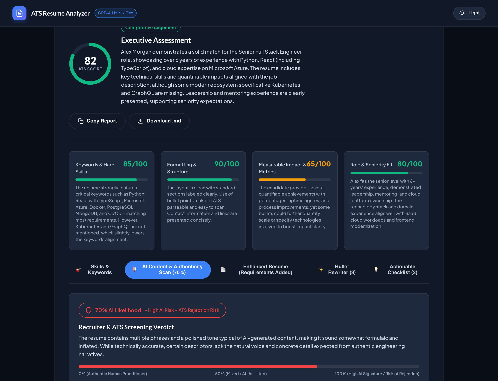
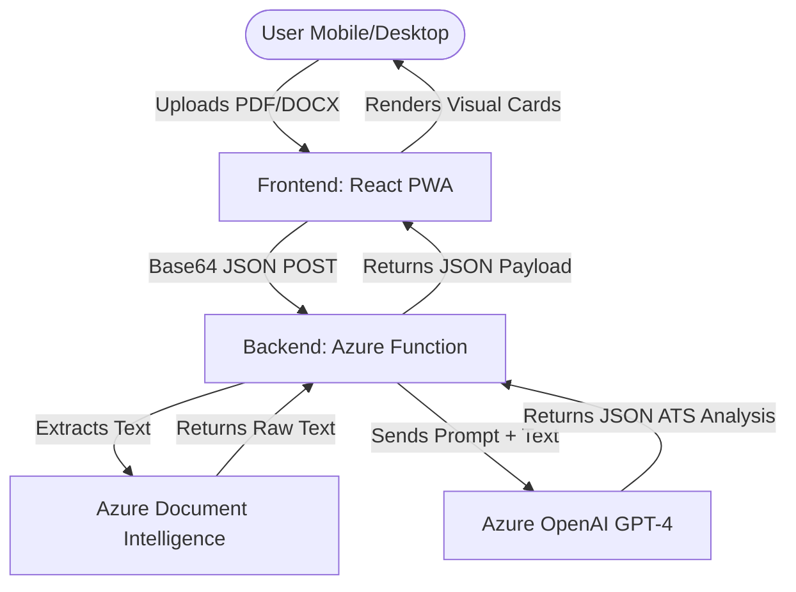

# AI Resume Analyzer

An intelligent, fully responsive, and cloud-hosted application that evaluates your resume against industry standards, extracting key skills, identifying missing skills, and providing actionable suggestions using Azure Document Intelligence and Azure OpenAI.



## Architecture Diagram



## Project Structure

The codebase is split into two distinct parts for easy deployment and maintenance:

```text
.
├── frontend/                 # React UI (Progressive Web App)
│   ├── build/                # Production-ready compiled code
│   ├── public/               # Static assets & manifest.json
│   ├── src/                  # React components, styles, and service workers
│   └── package.json          # Frontend dependencies
│
└── backend/                  # Azure Functions Python Backend
    ├── function_app.py       # Main API endpoint & logic
    ├── requirements.txt      # Python dependencies (azure-ai-formrecognizer, openai)
    ├── host.json             # Azure Function host config
    └── local.settings.json   # Environment variables / Key Vault reference
```

## Features
- **Clean Minimalist Modern UI**: Crisp typography (Plus Jakarta Sans & Inter), hairline borders, and fluid Light/Dark theme toggle with automatic preference memory.
- **Target Job Description Comparison**: Compare resumes against a specific job posting to measure exact role alignment and uncover tailored keyword gaps.
- **Multi-Dimensional ATS Scorecard**: Circular SVG gauge and 4 distinct sub-scores:
  - 🎯 **Keywords & Hard Skills Match**
  - 📐 **Formatting & ATS Parseability**
  - 📈 **Measurable Impact & Metrics**
  - 👔 **Role & Seniority Fit**
- **AI Bullet Point Rewriter**: Scans weak bullet points from the resume and rewrites them into high-impact, metric-driven statements with one-click copy.
- **⚡ Instant Demo Resume**: One-click test button pre-loaded with a realistic software engineering resume and job description.
- **Audit Export**: One-click "Copy Summary" to clipboard and "Download Report (.md)" for offline review.
- **Cloud Infrastructure**: Powered by Azure Functions (Flex Consumption `FC1`), Azure Key Vault, Azure Document Intelligence, and Azure OpenAI (`gpt-4.1-mini`).

## Deployment

### Frontend (`/frontend`)
The frontend is a static React app. Build it using `npm run build` and deploy it to Azure App Service or Azure Static Web Apps:
```bash
cd frontend
npm run build
cd build
az webapp up --name <your-app-name> --html --resource-group <your-resource-group>
```

### Backend (`/backend`)
The backend is a Python Azure Function running on the **Azure Functions Flex Consumption plan** (`FC1`). Deploy updates using Azure Functions Core Tools:
```bash
cd backend
func azure functionapp publish ajf-resume-analyzer-flex --python
```
Or using Azure CLI zip deployment:
```bash
az functionapp deploy --resource-group <your-resource-group> --name ajf-resume-analyzer-flex --src-path <package.zip> --type zip
```
